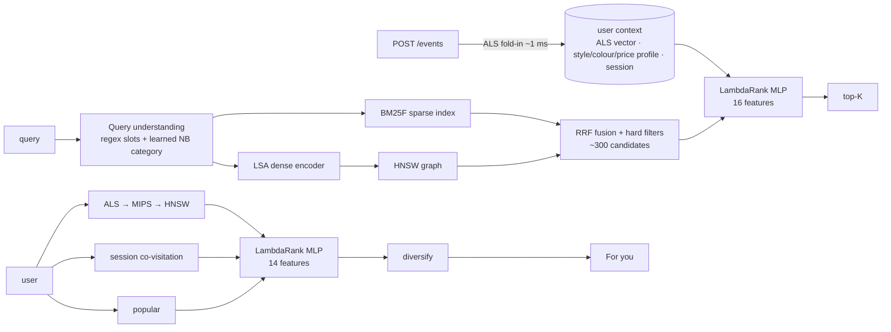
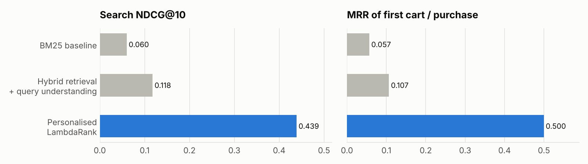
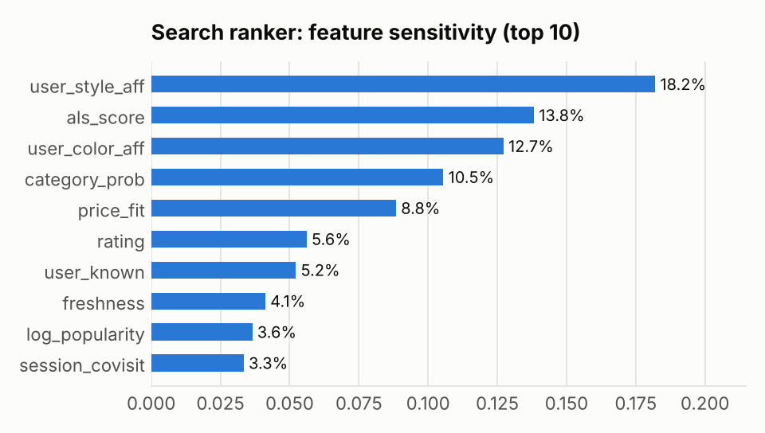
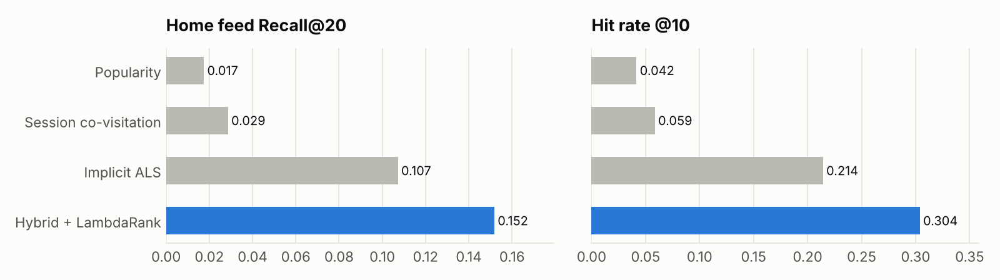
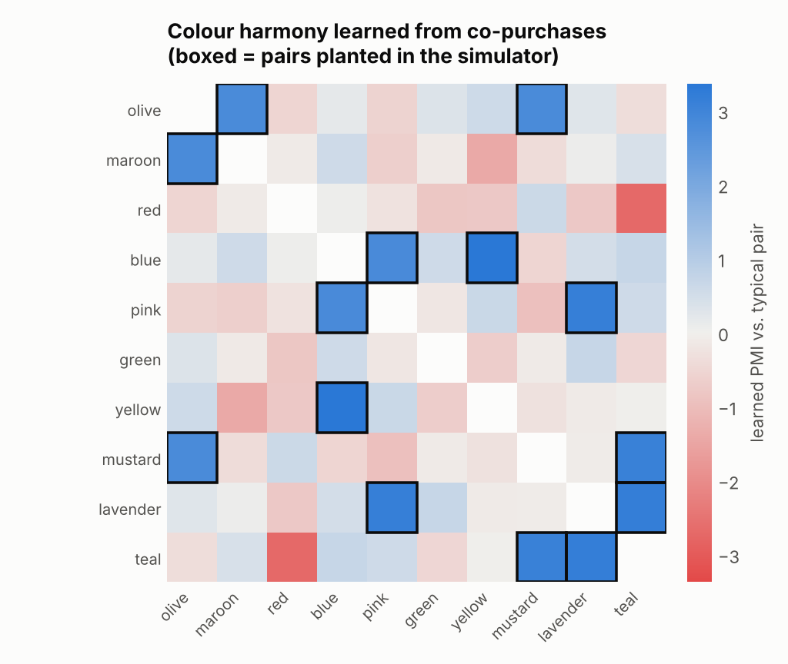
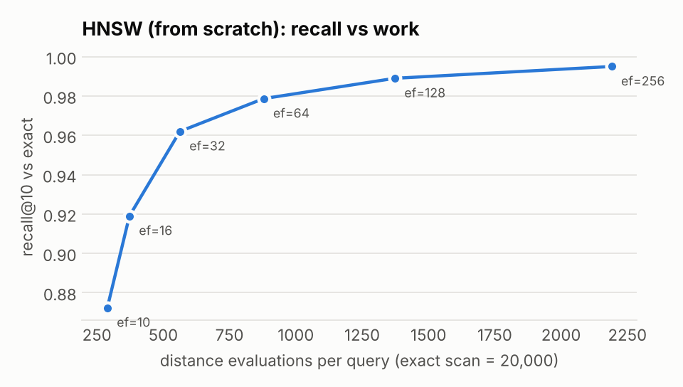

# Drape — personalised fashion search & recommendation engine

**Type "navy linen shirt for office under 2k" and get *your* navy linen shirts.**
Drape is the system behind the search bar, the "For you" feed and the "Complete the look"
strip of a fashion store. It understands the query, retrieves candidates from 20,000 products
in ~7 ms, and re-ranks them for the shopper with a learning-to-rank model. Every click updates
the shopper's taste vector live.

Every core algorithm is implemented from scratch in NumPy/SciPy, with no ML libraries:
BM25F, LSA embeddings, **HNSW** approximate nearest-neighbour search, **implicit ALS**
matrix factorisation, **LambdaRank** with an MLP scorer, a Naive Bayes query classifier and a
learned outfit-compatibility model. It is served with FastAPI and comes with a web UI,
22 tests, a load test and a Dockerfile.

| | Baseline | Drape | Lift |
|---|---|---|---|
| Search NDCG@10 | 0.060 (BM25) | **0.439** | **7.3×** |
| Search MRR of first cart/purchase | 0.057 (BM25) | **0.500** | **8.8×** |
| Home-feed Recall@20 | 0.107 (ALS alone) | **0.152** | **+42%** |
| Home-feed Hit@10 | 0.214 (ALS alone) | **0.304** | **+42%** |
| Complete-the-look AUC | 0.5 (random) | **0.894** | |
| HNSW recall@10 | exact scan, 20,000 distance evals | **0.979** with 879 evals | **23× less work** |
| Serving latency (p50, 1 process) | | search 8 ms · feed 18 ms · product page 15 ms · live update 3 ms | |

All numbers are held-out and time-split (protocol below). They come from `artifacts/results.json`,
which `python -m scripts.train` regenerates.

---

## What a shopper sees

1. **Search that understands intent.** For `"burgundy blazer for women for office under 5k"` the parser extracts
   colour=maroon (via a synonym), gender=women, style hint=formal and price≤5000. A classifier trained
   on search logs predicts category=blazer (0.99). It learned on its own that *sweatshirt→hoodie*,
   *khakis→chinos* and *bag* → {backpack 0.96, handbag 0.04} for "bag for college". Typos like
   "sneekers" still work because of character-trigram embeddings.
2. **A "For you" feed.** Candidates come from three sources (ALS via HNSW, session co-visitation and
   popularity) and are re-ranked by a second LambdaRank model.
3. **Product page.** It shows *Similar items*, which blend "looks like" (text embedding) with "shopped like"
   (ALS + co-visitation). It also shows *Complete the look*, one pick per complementary slot from a learned
   compatibility model.
4. **Real-time personalisation.** `POST /events` refits the user vector with ALS fold-in in ~1 ms,
   with no retraining, and invalidates that user's cached results.

## Architecture



| Layer | Implementation (all from scratch) | File |
|---|---|---|
| Lexical retrieval | BM25F with field boosts. Every (term, doc) weight is precomputed in a CSR matrix, so a query is one sparse mat-vec | `drape/search/bm25.py` |
| Dense retrieval | TF-IDF over words, bigrams and char-trigrams → truncated SVD (LSA, 96-d), typo-tolerant | `drape/search/semantic.py` |
| ANN index | HNSW: multi-layer graph, Algorithm-4 diversity heuristic, keepPruned. MIPS reduced to L2 via Bachrach augmentation | `drape/ann/hnsw.py` |
| Query understanding | Price/colour/gender/occasion extraction plus a multinomial Naive Bayes category model trained on query→purchase logs | `drape/search/query_parser.py` |
| Collaborative filtering | Implicit ALS (Hu–Koren–Volinsky) with a conjugate-gradient solver; exact fold-in for live users | `drape/recs/als.py` |
| Co-visitation | Session×item matrix → cosine-normalised item graph, top-50 per item | `drape/recs/covisit.py` |
| Learning to rank | LambdaRank (ΔNDCG-weighted pairwise gradients), MLP + linear skip, Adam, manual backprop | `drape/rank/ltr.py` |
| Outfit model | Colour-pair and style-pair PMI learned from co-purchases, plus price/tier/ALS features → logistic regression | `drape/recs/outfit.py` |
| Serving | FastAPI, LRU cache with per-user version invalidation, per-endpoint p50/p95/p99, web UI | `drape/api/` |

## Results



Hybrid retrieval with query understanding doubles BM25. The personalised ranker adds the big jump,
because most queries ("shorts") match hundreds of near-identical products. What separates them is
*who* is asking. The ranker's most-used features are style affinity, the ALS score and colour affinity:





**The outfit model rediscovered colour theory.** The simulator plants 7 harmonious non-neutral colour
pairs (olive+mustard, blue+yellow, …) in user behaviour. The model only ever sees co-purchases,
and its 7 highest-PMI pairs are exactly those 7 (precision 7/7). AUC on held-out co-purchases is 0.894.
The true complement lands in the top-50 of its slot 36.7% of the time, against 2.1% at random:



**HNSW.** It reaches 0.979 recall@10 at ef=64 while computing 879 distances instead of 20,000.
To be clear about the trade-off: at 20k items, NumPy brute force (0.36 ms, vectorised C) still beats
a pure-Python graph walk (1.1 ms). The index is there because its work grows logarithmically, so it
is the component that scales to millions of products. In production this would be FAISS or ScaNN.



**Serving.** Measurements are from 1 uvicorn process on 2 vCPUs shared with the load generator.

| endpoint | p50 / p99 at concurrency 1 |
|---|---|
| `GET /search` (uncached, personalised) | 8 ms / 15 ms *(offline eval; cache hits ~3 ms)* |
| `GET /recommend/{user}` | 18 ms / 28 ms |
| `GET /items/{id}` (similar + complete-the-look) | 15 ms / 23 ms |
| `POST /events` (profile + ALS fold-in) | 3 ms / 7 ms |

Throughput is about 110 req/s per process. At 16 concurrent clients it is about 75 req/s, and the
added latency is queueing, because Python holds the GIL. Handlers are deliberately `async` so that
CPU-bound work doesn't thrash a thread pool. You scale this with processes, not threads.

## Evaluation protocol (no leakage)

```
day 0 ──────────────── 90 ──────────── 105 ──────────── 120
   fit models (E1)      │ train rankers │
          fit models (E2)               │   TEST          │
```

* Rankers learn on days 90–105 from features computed by models frozen at day 90. ALS never saw the labels.
* Test metrics use days 105–120 with models refit at day 105. Session context only uses events
  strictly before each query.
* **A bug worth telling:** event timestamps are float32. A session's first click could round to
  *just before* the query timestamp and leak into its own context, which affected 49% of queries.
  It's fixed with a guard band and a regression test (`test_offline_context_never_leaks_the_query_session`).
  NDCG moved by less than 0.001, so the gains are real, but the bug is exactly what offline/online skew looks like.
* Features are computed by one shared function for training and serving (`drape/rank/features.py`), so there is no train/serve skew.

## Data

There is no public dataset with product text, search queries, sessions *and* outfit co-purchases,
so `drape/data/generator.py` simulates a store with 20k products, 6k shoppers, 57k search sessions
and 563k view/cart/purchase events. Each shopper has hidden preferences over style, colour and price.
Queries are typed with real-world variety ("denims", "track pants", "under 1500"). After a purchase,
shoppers often "complete the look" with colour-harmonious items. Because the ground truth is known,
every metric is checkable. The loader interface is one function, so you can swap in the
H&M Kaggle dataset for real-data numbers.

Honest caveats:
* Query-category accuracy (99%) is high because simulated queries are cleaner than real ones.
* Absolute metric values depend on the simulator. The *relative* ordering of methods is what transfers.

## Run it

```bash
pip install -r requirements.txt
python -m scripts.train          # simulate → fit → train rankers → evaluate → export  (~11 min, 2 cores)
uvicorn drape.api.server:app --port 8000      # open http://localhost:8000
python -m pytest -q              # 22 tests
python -m scripts.loadtest       # concurrent load test against the running server
# or: docker build -t drape . && docker run -p 8000:8000 drape
```

`python -m scripts.train --quick` builds a 4k-item world in ~2 minutes.

## API

| | |
|---|---|
| `GET /search?q=&user_id=&k=&mode=ltr\|hybrid\|bm25` | results + parsed query + stage timings |
| `GET /recommend/{user_id}?mode=ltr\|als\|covisit\|popular` | home feed |
| `GET /items/{id}` | product, similar items, complete-the-look |
| `POST /events {user_id,item_id,type}` | live update (view/cart/purchase) |
| `GET /users/{id}` | learned taste profile |
| `GET /trending` · `/stats` · `/health` · `/docs` | |

## Project layout

```
drape/
  data/        schema (catalog vocabulary) + behavioural simulator
  text/        tokenizer + stemmer shared by index & query time
  search/      BM25F, LSA encoder, query parser + NB classifier
  ann/         HNSW + MIPS transform
  recs/        implicit ALS, co-visitation, outfit model
  rank/        LambdaRank MLP + shared feature builders
  eval/        metrics + time-split offline evaluation
  engine.py    orchestration: retrieval → ranking, feeds, product page, live updates
  api/         FastAPI server + single-file web UI
scripts/       train.py (pipeline), plots.py, loadtest.py
tests/         unit tests per algorithm + end-to-end + API tests
```

## What I'd do next

* Swap LSA for a fine-tuned two-tower model (query tower and item tower trained on query→purchase pairs).
* Move live user state into Redis so the server can run N workers. Move HNSW to FAISS.
* Run interleaving or A/B tests online. Add counterfactual (IPS) correction for position bias in the click logs.
* Add image embeddings (CLIP) so compatibility can see visual style, not just attributes.
